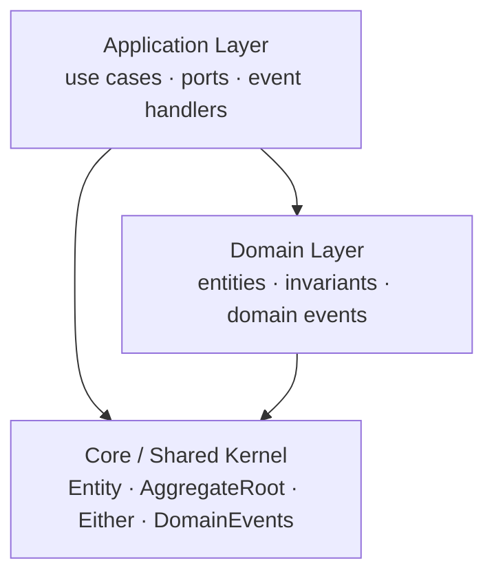
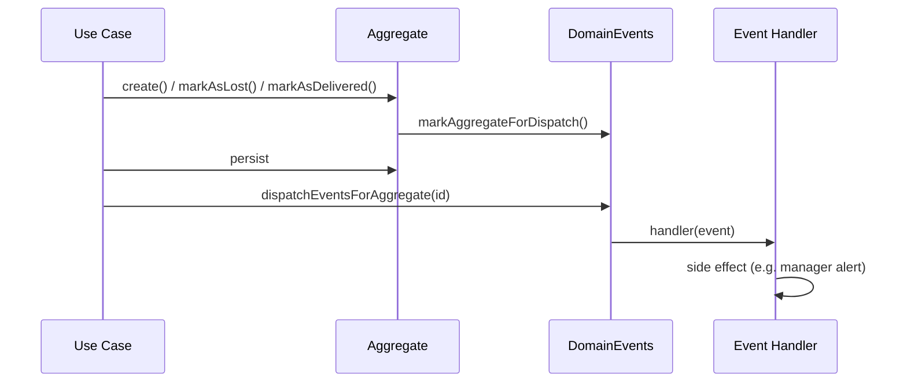

# Sales Analytics CRM — Domain Core

A **Customer Relationship Management (CRM)** core for sales analytics, built with **TypeScript**, **Domain-Driven Design (DDD)** and **Clean Architecture**.

This repository contains the **domain and application core**: entities, business rules, use cases and domain events — fully decoupled from any framework, database or HTTP framework. It is the heart of a REST API for sales teams, where **Salespersons** manage **Clients** and **Sales Opportunities**, and **Managers** get notified about high-value deals.

## Table of Contents

- [Features](#features)
- [Business Rules](#business-rules)
- [Tech Stack](#tech-stack)
- [Getting Started](#getting-started)
- [Project Structure](#project-structure)
- [Architecture](#architecture)
- [Domain Events](#domain-events)
- [Testing](#testing)
- [Documentation](#documentation)
- [Roadmap](#roadmap)

## Features

- [x] Two user roles: **Salesperson** and **Sales Manager**.
- [x] Authentication with e-mail and password (returns an access token).
- [x] CRUD for salespersons (manager-only).
- [x] CRUD for clients.
- [x] CRUD for sales opportunities.
- [x] Password changes (managers can change salespersons' passwords).
- [x] List the sales of a given salesperson.
- [x] Notify the manager on every high-value sales opportunity update.

## Business Rules

- [x] Only **managers** can perform CRUD operations on salespersons.
- [x] Only the **logged-in salesperson** can manage their own clients (managers can list any).
- [x] Marking an opportunity as **delivered requires a delivery photo**.
- [x] Only the manager can change a salesperson's password.
- [x] A salesperson **cannot list another salesperson's** sales.
- [x] Every client must have an associated salesperson — the **first one is the salesperson who created the client**.
- [x] Every sales opportunity must be associated with a **client** and a **salesperson**.
- [x] The salesperson who creates an opportunity is its **first owner**.
- [x] Opportunities can only be marked as **lost** while `open` or `in_progress`.
- [x] Opportunities can only be marked as **delivered** from the `won` status.

## Tech Stack

| Concern          | Tool                                                            |
| ---------------- | --------------------------------------------------------------- |
| Language         | [TypeScript](https://www.typescriptlang.org/) (strict mode)      |
| Runtime          | [Node.js](https://nodejs.org/)                                   |
| Test runner      | [Vitest](https://vitest.dev/)                                    |
| Test data        | [@faker-js/faker](https://fakerjs.dev/)                          |
| Linter           | [ESLint](https://eslint.org/) + typescript-eslint                |
| Package manager  | [pnpm](https://pnpm.io/)                                         |

## Getting Started

### Prerequisites

- [Node.js](https://nodejs.org/) (LTS)
- [pnpm](https://pnpm.io/) (`corepack enable` or `npm i -g pnpm`)

### Installation

```bash
pnpm install
```

### Scripts

| Command           | Description                    |
| ----------------- | ------------------------------ |
| `pnpm test`       | Run the full test suite once   |
| `pnpm test:watch` | Run tests in watch mode        |

## Project Structure

```text
sales-crm-core/
├── src/
│   ├── core/                        # Shared kernel (framework-agnostic)
│   │   ├── either.ts                #   Either<L, R> — functional error handling
│   │   ├── entities/                #   Entity, AggregateRoot, ValueObject,
│   │   │                            #   UniqueEntityID, WatchedList
│   │   ├── errors/                  #   Base and common use-case errors
│   │   ├── events/                  #   DomainEvents pub/sub bus
│   │   └── types/                   #   Optional<T, K> utility type
│   └── main/crm/
│       ├── app/                     # Application layer
│       │   ├── cases/               #   Use cases + use-case-specific errors
│       │   ├── cryptography/        #   Ports: Encrypter, HashComparer, HashGenerator
│       │   ├── handlers/            #   Domain event handlers (subscriptions)
│       │   └── repos/               #   Repository ports (abstract classes)
│       └── enterprise/              # Domain layer
│           ├── entities/            #   Client, Salesperson, SalesOpportunity
│           │   ├── enum/            #   Role and status enums
│           │   └── errors/          #   Entity-level errors
│           └── events/              #   Domain event definitions
├── tests/                           # Test doubles and factories
│   ├── encryptography/              #   Fake encrypter / hasher
│   ├── factories/                   #   make-client, make-salesperson, ...
│   └── repos/                       #   In-memory repository implementations
└── docs/                            # Architecture & design documentation
```

## Architecture

The solution follows **Clean Architecture** with a strict **dependency rule**: dependencies always point inward, and the domain layer knows nothing about the application layer or any external concern.



- **Core** — generic building blocks: `Entity`, `AggregateRoot`, `ValueObject`, `UniqueEntityID`, `WatchedList`, the `Either` pattern and the `DomainEvents` bus.
- **Domain (enterprise)** — pure business rules: entities (`Client`, `Salesperson`, `SalesOpportunity`), their invariants and the domain events they raise.
- **Application (app)** — use cases (`RegisterSalespersonUseCase`, ...), repository and cryptography **ports** (abstract interfaces), and domain event handlers.

Each use case returns an `Either<L, R>`: a `left` with a typed domain error or a `right` with the result — no exceptions for expected failures.

📖 Deep dive: [docs/architecture.md](docs/architecture.md) · [docs/domain-model.md](docs/domain-model.md)

## Domain Events

Aggregates raise **domain events** when something meaningful happens (an opportunity was created, went over a value threshold, changed status, was lost or delivered). Events are collected on the aggregate and dispatched by the `DomainEvents` static bus after the use case persists, following a **store-then-dispatch** flow.



For example, updating an opportunity's value to **10,000 or more** raises a `SalesOpportunityHighValueEvent`, and the `OnHighValueSalesOpportunityUpdated` handler notifies the manager.

📖 Deep dive: [docs/domain-events.md](docs/domain-events.md)

## Testing

The test suite is **unit-level and dependency-free**: every use case is tested against **in-memory repository implementations**, **fake cryptography** (`FakeHasher`, `FakeEncrypter`) and **faker-based factories** (`makeClient`, `makeSalesperson`, `makeSalesOpportunity`) — no database, no mocking framework.

```bash
pnpm test
```

📖 Strategy and patterns: [docs/testing.md](docs/testing.md)

## Documentation

| Document                                          | Contents                                                       |
| ------------------------------------------------- | -------------------------------------------------------------- |
| [Architecture](docs/architecture.md)              | Layers, dependency rule, core building blocks, use case pattern |
| [Domain Model](docs/domain-model.md)              | Aggregates, enums, invariants, opportunity state machine        |
| [Domain Events](docs/domain-events.md)            | Event catalog, handlers, dispatch flow, how to add a new event  |
| [Testing](docs/testing.md)                        | Test strategy, doubles, factories, conventions                  |

## Roadmap

The repository currently holds the **domain + application core**. The next steps to turn it into a complete REST API:

- [ ] HTTP layer (controllers, routes, middlewares)
- [ ] Real cryptography (bcrypt/argon2) and JWT signing adapters
- [ ] Persistence layer (PostgreSQL + repositories implementations, migrations)
- [ ] Role-based authentication middleware
- [ ] Real notification channel for manager alerts (e-mail / push)
- [ ] End-to-end tests

## Skills practiced

- Domain-Driven Design (aggregates, entities, value objects, invariants)
- Domain Events and event-driven side effects
- Clean Architecture and the dependency rule
- Functional error handling with `Either`
- Unit testing with test doubles and factories
