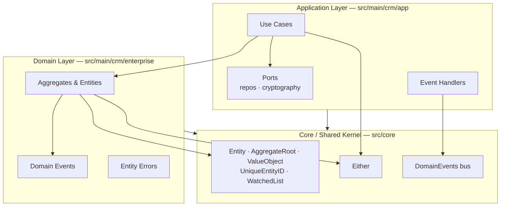

# Architecture

This project follows **Clean Architecture** combined with **Domain-Driven Design (DDD)**. The goal is a system that is robust, modular and easy to maintain, where the business rules are the most protected part of the codebase and everything else (frameworks, databases, HTTP) is a replaceable detail.

## The Dependency Rule

Dependencies always point **inward**. The domain layer knows nothing about the application layer, and neither of them knows anything about infrastructure. In this repository, "inward" means depending only on `src/core`.



No layer imports HTTP, database or environment concerns — that is what makes the whole core testable with plain in-memory doubles.

## Layers

### Core (shared kernel)

Framework-agnostic building blocks used by every other layer.

| Building block   | Purpose                                                                                                    |
| ---------------- | ---------------------------------------------------------------------------------------------------------- |
| `Entity`         | Base class with identity. Two entities are equal when their `UniqueEntityID` matches, not their attributes. |
| `AggregateRoot`  | Extends `Entity` with a list of domain events and the ability to register them for dispatch.                 |
| `ValueObject`    | Base class for objects defined by their attributes (no identity).                                           |
| `UniqueEntityID` | Wraps the ID generation, so entities can be created with or without a pre-set id.                            |
| `WatchedList`    | Tracks items added/removed on a collection to compute diffs.                                                 |
| `Either<L, R>`   | Functional error handling: a use case returns `left(error)` for failure or `right(result)` for success.      |
| `Optional<T, K>` | Utility type marking props `K` of `T` as optional on creation.                                               |
| `DomainEvents`   | Static pub/sub bus: aggregates are marked for dispatch, then their events are dispatched to registered handlers. |

### Domain layer (`src/main/crm/enterprise`)

The heart of the project: **pure business rules** with zero external dependencies.

- **Aggregates** — `Salesperson`, `Client` and `SalesOpportunity`. Each one owns its invariants (enforced in methods like `markAsDelivered`), keeps its own `createdAt`/`updatedAt` timestamps and raises domain events through `AggregateRoot`.
- **Enums** — `SalespersonRole`, `ClientStatus`, `SalesOpportunityStatus`.
- **Entity errors** — errors raised by invariants, e.g. `SalesOpportunityPhotoRequiredError`, `CantMarkSalesOpportunityAsLostError`.
- **Domain events** — one class per meaningful occurrence (see [domain-events.md](domain-events.md)).

### Application layer (`src/main/crm/app`)

Orchestrates the domain without ever implementing business rules itself.

- **Use cases (`cases/`)** — one class per flow, each with a single public `execute()` method. Example:

  ```ts
  type Response = Either<
    SalespersonAlreadyExistsError | NotAllowedError | SalespersonNotFoundError,
    { salesperson: Salesperson }
  >;

  export class RegisterSalespersonUseCase {
    constructor(
      private salespersonsRepo: SalespersonsRepo, // port
      private hashGenerator: HashGenerator        // port
    ) {}

    async execute(request): Promise<Response> {
      // 1. load the executor and check authorization
      // 2. check uniqueness rules
      // 3. delegate invariants to the aggregate (Salesperson.create)
      // 4. persist through the port
      // 5. DomainEvents.dispatchEventsForAggregate(...)
      // 6. return right(...) or left(...)
    }
  }
  ```

  Use-case-specific errors live next to the cases (`cases/errors/`), while generic ones (`NotAllowedError`, `ResourceNotFoundError`, `WrongCredentialsError`) live in `core/errors/`.

- **Ports (`repos/`, `cryptography/`)** — abstract classes defining what the application needs, not how it is done:
  - `SalespersonsRepo`, `ClientsRepo`, `SalesOpportunitiesRepo`
  - `HashGenerator` / `HashComparer` (password hashing) and `Encrypter` (token signing)

  Concrete implementations (PostgreSQL repositories, bcrypt, JWT) are injected via constructor and live outside this repository — currently only the in-memory test doubles exist.

- **Event handlers (`handlers/`)** — subscribe to domain events on construction via `DomainEvents.register(...)` and perform side effects (today, console alerts).

## Data flow of a use case

1. The caller (a future HTTP controller) builds the request and calls `useCase.execute(request)`.
2. The use case loads aggregates through **ports**, never raw data structures.
3. Authorization and cross-aggregate checks happen in the use case; **invariants live inside the aggregate methods**.
4. Mutating an aggregate queues a **domain event** and marks the aggregate for dispatch.
5. After persisting, the use case calls `DomainEvents.dispatchEventsForAggregate(id)`.
6. The use case returns `right(result)` or `left(error)` — expected failures never throw.

## How to add a new feature

1. **Model the language**: add/extend an aggregate or value object in `enterprise/` with its invariants and (if meaningful) a domain event.
2. **Write the use case** in `app/cases/`, declare its request/response types and its errors.
3. **Declare or extend a port** if new infrastructure is needed.
4. **Write the unit tests first** against in-memory doubles (see [testing.md](testing.md)).
5. Register any new event handler in `app/handlers/`.
