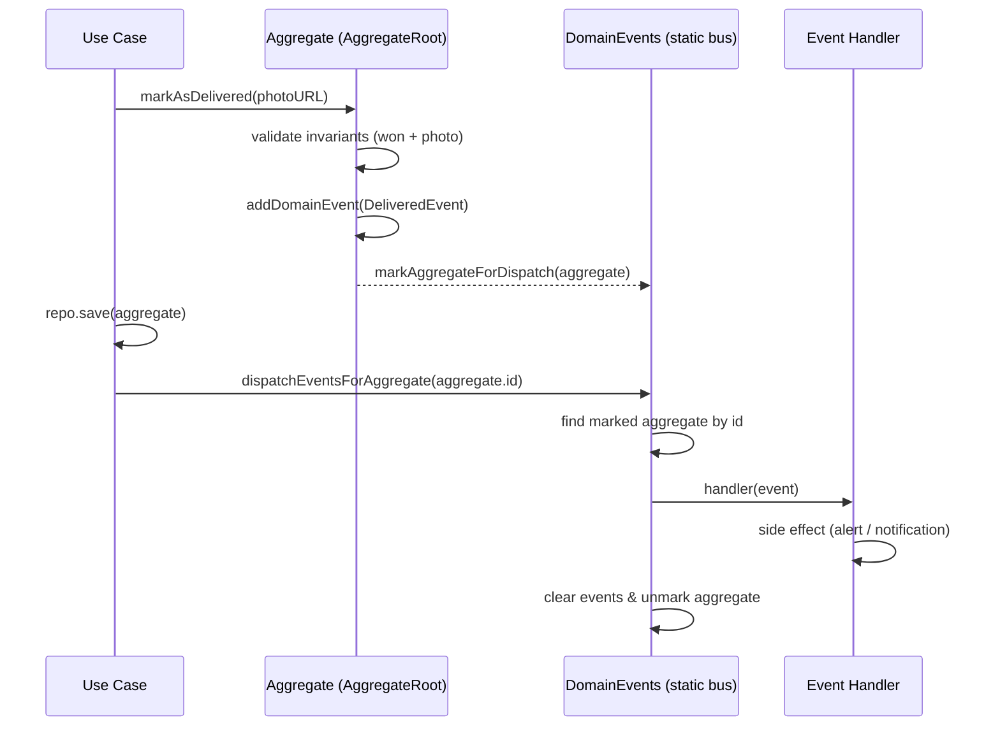

# Domain Events

Domain events express that something meaningful happened in the domain, in the past tense. They decouple **what happened** (the aggregate) from **what to do about it** (the side effects), keeping business rules free of notification/persistence concerns.

## The building blocks

| Piece                       | Role                                                                               |
| --------------------------- | ---------------------------------------------------------------------------------- |
| `DomainEvent` (interface)   | `ocurredAt: Date` + `getAggregateID(): UniqueEntityID`                              |
| `AggregateRoot`             | Holds `_domainEvents`; `addDomainEvent()` also marks the aggregate for dispatch      |
| `DomainEvents` (static bus) | Registry of `event name → handlers`; dispatches marked aggregates' events on demand  |
| `EventHandler` (interface)  | `setupSubscriptions()` — handlers self-register in their constructor                 |

## Event catalog

| Event                              | Raised when                                            | Handler                              | Side effect              |
| ---------------------------------- | ------------------------------------------------------ | ------------------------------------ | ------------------------ |
| `SalesPersonEvent`                 | A new salesperson is created                           | —                                    | —                        |
| `ClientCreatedEvent`               | A new client is created                                | —                                    | —                        |
| `SalesOpportunityCreatedEvent`     | A new sales opportunity is created                     | `OnSalesOpportunityCreated`          | Console alert            |
| `SalesOpportunityHighValueEvent`   | `updateValue()` sets the value to **≥ 10,000**         | `OnHighValueSalesOpportunityUpdated` | Manager alert (console)  |
| `SalesOpportunityStatusUpdatedEvent` | `updateStatus()` actually changes the status         | `OnSalesOpportunityStatusUpdated`    | Status-change alert      |
| `SalesOpportunityLostEvent`        | `markAsLost()` succeeds                                | `OnLostSalesOpportunityUpdated`      | Lost-deal alert          |
| `SalesOpportunityDeliveredEvent`   | `markAsDelivered()` succeeds                           | `OnDeliveredSalesOpportunityUpdated` | Delivered-deal alert     |

## Dispatch flow

The bus is **store-then-dispatch**: mutating an aggregate only *queues* the event; the use case dispatches it **after** the aggregate is persisted, so handlers never run for data that was not saved.



Key behaviors of the bus:

- An aggregate is marked **once** even if several events are queued.
- `dispatchEventsForAggregate(id)` only dispatches for the aggregate with that exact id.
- `DomainEvents.shouldRun = false` disables dispatch globally (useful in tests).
- `clearHandlers()` / `clearMarkedAggregates()` reset the bus between tests.

## Writing a handler

Handlers subscribe in the constructor and are bound to keep `this` working:

```ts
export class OnHighValueSalesOpportunityUpdated implements EventHandler {
  constructor() {
    this.setupSubscriptions();
  }

  setupSubscriptions() {
    DomainEvents.register(
      this.notifyManager.bind(this),
      SalesOpportunityHighValueEvent.name, // dispatch is name-based
    );
  }

  private async notifyManager({ salesOpportunity }: SalesOpportunityHighValueEvent) {
    // e-mail, push, message queue... (today: console alert)
  }
}
```

## How to add a new event

1. Create the event class in `enterprise/events/`, implementing `DomainEvent` and carrying the aggregate (or a snapshot) as public state.
2. Raise it in the aggregate method with `this.addDomainEvent(new MyEvent(this))`.
3. Create a handler in `app/handlers/`, subscribe with `DomainEvents.register(cb, MyEvent.name)`, and instantiate it once during composition root setup.
4. Dispatch after persisting in the use case: `DomainEvents.dispatchEventsForAggregate(aggregate.id)`.
5. Assert on the handler's side effect in the use case tests.

> **Known trade-off:** `DomainEvents` dispatches by `event.constructor.name`, so minification/renaming can break subscriptions in production builds — a registry keyed by explicit event type strings is the usual hardening step.
