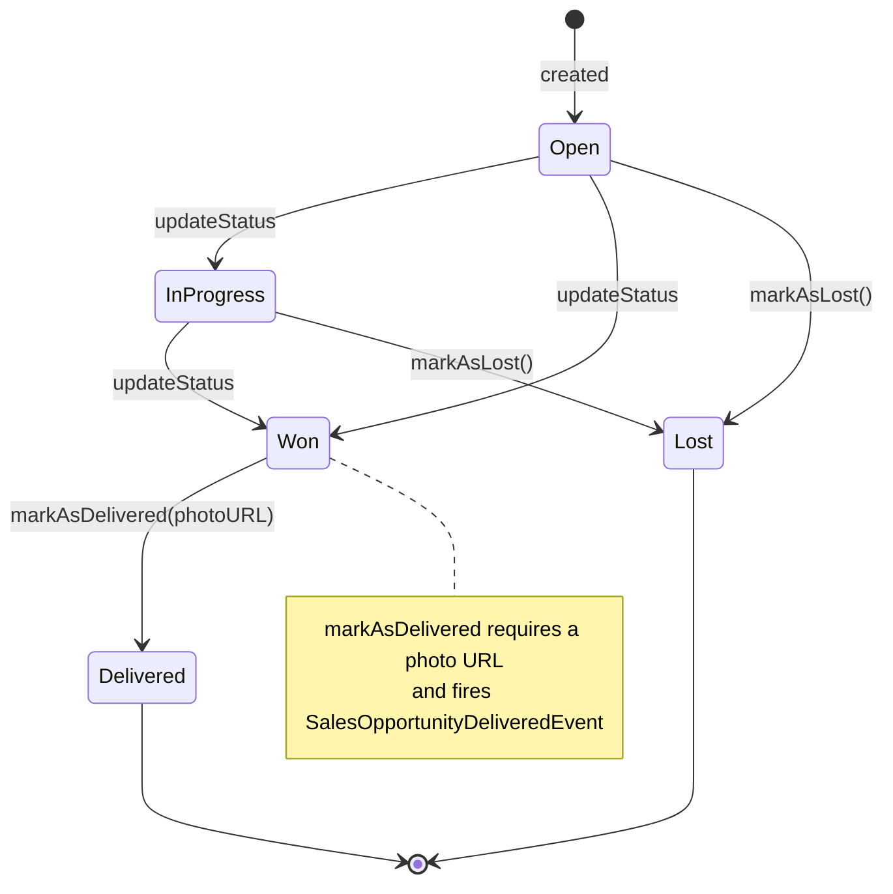

# Domain Model

This document describes the aggregates, their invariants and the sales opportunity life cycle. For how side effects are triggered from these models, see [domain-events.md](domain-events.md).

## Aggregates

All three aggregates extend `AggregateRoot`, so they own identity, timestamps and domain events.

### Salesperson

A user of the system. Can be a `salesperson` (default role) or a `manager`.

| Property       | Type              | Notes                          |
| -------------- | ----------------- | ------------------------------ |
| `name`         | `string`          |                                |
| `email`        | `string`          | Unique (enforced by use case)  |
| `passwordHash` | `string`          | Never stored in plain text     |
| `phone`        | `string`          |                                |
| `role`         | `SalespersonRole` | Default: `salesperson`         |
| `isActive`     | `boolean`         | Default: `true`                |

Behaviors: `updateName`, `updateEmail`, `updatePasswordHash`, `updatePhone`, `updateRole`, `activate`, `deactive`. Inactive salespersons cannot authenticate (`SalespersonDeactiveError`).

### Client

A customer owned by a salesperson.

| Property      | Type            | Notes                                                     |
| ------------- | --------------- | --------------------------------------------------------- |
| `creatorID`   | `UniqueEntityID`| Defaults to `salesRepID` — the first salesperson is the creator |
| `name`        | `string`        |                                                           |
| `email`       | `string`        |                                                           |
| `phone`       | `string`        |                                                           |
| `segment`     | `string`        |                                                           |
| `status`      | `ClientStatus`  | Default: `lead`                                           |
| `salesRepID`  | `UniqueEntityID`| Current responsible salesperson                           |

Invariants enforced by use cases: only the logged-in salesperson manages their own clients; every client always has a salesperson associated.

### Sales Opportunity

The deal itself, tied to one client and one salesperson.

| Property           | Type                      | Notes                                        |
| ------------------ | ------------------------- | -------------------------------------------- |
| `creatorID`        | `UniqueEntityID`          | Salesperson who created the opportunity      |
| `clientID`         | `UniqueEntityID`          |                                              |
| `salesRepID`       | `UniqueEntityID`          | Current owner                                |
| `title`            | `string`                  |                                              |
| `description`      | `string`                  |                                              |
| `value`            | `number`                  | Updates ≥ 10,000 raise the high-value event  |
| `status`           | `SalesOpportunityStatus`  | Default: `open`                              |
| `deliveryPhotoURL` | `string \| null`          | Required to deliver                          |

## Enums

```ts
enum SalespersonRole { saleperson = "salesperson", manager = "manager" }
enum ClientStatus { lead = "lead", active = "active", inactive = "inactive" }
enum SalesOpportunityStatus { open, inProgress = "in_progress", won, lost, delivered }
```

## Opportunity State Machine

Two transitions are **guarded by invariants** on the aggregate:

- `markAsLost()` — only from `open` or `in_progress`, otherwise `CantMarkSalesOpportunityAsLostError`.
- `markAsDelivered(photoURL)` — only from `won`, and a non-empty `photoURL` is mandatory (`SalesOpportunityWrongStatusError` / `SalesOpportunityPhotoURLRequiredError`).



The generic `updateStatus()` performs unguarded transitions and raises `SalesOpportunityStatusUpdatedEvent` whenever the status actually changes — the guarded methods above are the business-approved paths.

## Creation defaults

Every aggregate uses the same creation pattern (`static create(props, id?)`):

- Missing props get defaults (`status`, `role`, `isActive`, `createdAt`, `creatorID`).
- If no `id` is passed, the aggregate is considered **new** and its *created* domain event is queued — reloading an existing aggregate from the database with an explicit `id` does **not** re-raise creation events.
- `Optional<T, K>` keeps the constructor ergonomic while the getters expose a complete, always-valid aggregate.

## Error taxonomy

| Level              | Where                                  | Examples                                                        |
| ------------------ | -------------------------------------- | --------------------------------------------------------------- |
| Entity/invariant   | `enterprise/entities/errors/`          | `CantMarkSalesOpportunityAsLostError`, `SalesOpportunityPhotoURLRequiredError` |
| Use case           | `app/cases/errors/`                    | `SalespersonAlreadyExistsError`, `ClientNotFoundError`          |
| Shared kernel      | `core/errors/`                         | `NotAllowedError`, `ResourceNotFoundError`, `WrongCredentialsError` |

All of them implement the `UseCaseError` marker interface and travel inside the `left()` side of `Either`.
